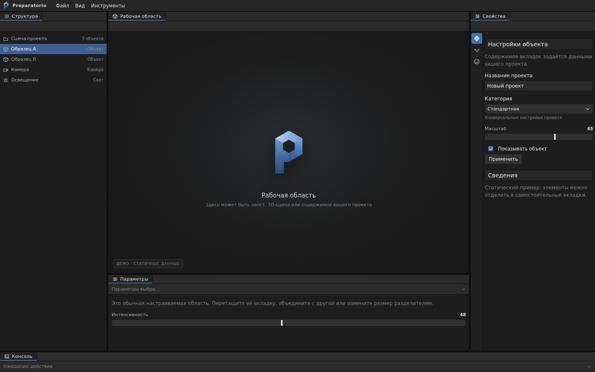

# framework-preparatorio

Каркас интерфейса редактора на областях (scope): реестр областей, связывание
паспорта с реализацией, управление доступностью элементов управления, вклады
меню и сборка приложения из движков.

Пакет не содержит кода конкретного приложения: в нём нет ни одного имени
панели, ни одной разметки и ни одной зависимости от 3D-движка. Области и их
содержимое поставляются приложением; каркас определяет порядок регистрации,
правила связывания и точку, где области попадают в интерфейс.



*Док с областями «Структура», «Рабочая область», «Свойства», «Параметры» и
«Консоль»; пункты меню «Вид» собираются из вкладов движков и областей.*

## Содержание

- [Назначение](#назначение)
- [Требования](#требования)
- [Установка](#установка)
- [Быстрый старт](#быстрый-старт)
- [Архитектура](#архитектура)
- [Контракт области](#контракт-области)
- [Доступность элементов управления](#доступность-элементов-управления)
- [Вклады меню](#вклады-меню)
- [Совместимость с uix-preparatorio](#совместимость-с-uix-preparatorio)
- [API](#api)
- [Тестирование](#тестирование)
- [Версионирование и синхронизация](#версионирование-и-синхронизация)
- [Лицензия](#лицензия)

## Назначение

Каркас решает четыре задачи:

| Задача | Механизм |
| --- | --- |
| Описать состав интерфейса | Паспорт области: идентификатор, зона дока, селектор, шаблон, инструменты |
| Связать описание с кодом | `bind`/`bindScopes`: реализация сопоставляется паспорту по `id` |
| Не показывать недоступное | `createScopeAvailability`: элементы управления гасятся, пока области нет |
| Собрать меню без ручных списков | Реестры вкладов «Вид» и «меню области» |

Каркас не выполняет: загрузку моделей, рендеринг, работу с файловой системой,
хранение пользовательских данных и построение дока. Док, рельсы, секции и
раскладка предоставляются библиотекой [`uix-preparatorio`](https://github.com/Kilyakus/uix-preparatorio);
каркас предоставляет правила, по которым области этих панелей появляются.

## Требования

- Node.js ≥ 20 (ESM, `node:test` для тестов).
- Для сборки — любой сборщик с поддержкой `import.meta.glob` (в приложении
  используется Vite) либо собственный обход файловой системы.
- Для браузерных подпутей `/menu`, `/shell`, `/browser` — `uix-preparatorio`.
- Ядро (`framework-preparatorio`) зависимостей не имеет.

## Установка

```bash
npm install git+https://github.com/Kilyakus/framework-preparatorio.git
```

`uix-preparatorio` устанавливается как зависимость пакета. Тема оформления
подключается отдельно, в приложении:

```js
import "uix-preparatorio/styles.css";
```

## Быстрый старт

Пример ниже собирает приложение из двух движков: у первого есть собственная
область, второй принимает контент и не имеет панелей.

### 1. Описать область

```js
// engine/viewport/src/registry.js
import template from "./template.js";

export default Object.freeze({
  kind: "scope",
  id: "viewport",
  areaId: "b-viewport-area",
  selector: ".b-viewport-area",
  label: "Просмотр",
  hideable: false,
  tools: [],
  template,
});
```

### 2. Описать движки

```js
// engines.js
const engines = [
  {
    id: "viewport",
    kind: "scope",
    plugins: { scopeDefinitions: [viewportPassport], loaders: [] },
    load: () => import("./engine/viewport/src/index.js"),
  },
  {
    id: "combat",
    plugins: { scopeDefinitions: [], loaders: [] },
    load: () => import("./engine/combat/src/index.js"),
  },
];
```

### 3. Собрать реестр

```js
import { createScopeRegistry, useScopeRegistry } from "framework-preparatorio";
import {
  registerScopeDefinitions,
  registerContributions,
} from "framework-preparatorio/composition";

const registry = createScopeRegistry();

registerScopeDefinitions(registry, {
  engines,
  pluginScopes: [weaponsPassport],       // области, приходящие с плагинами
  preferred: ["viewport", "weapons-scope"],
  engineOrder: ["viewport", "combat"],   // порядок инициализации движков
});

useScopeRegistry(registry);              // реестр становится текущим для оболочки
registerContributions(engines, registry.list());
```

### 4. Связать реализации и смонтировать разметку

```js
import { loadEnginePlugins, bindScopeImplementations } from "framework-preparatorio";
import { mountScopes } from "framework-preparatorio/scopes";

await loadEnginePlugins(engines);
await bindScopeImplementations(registry, { engines, loaders: pluginLoaders });
mountScopes(document);
```

`bindScopeImplementations` подгружает код только на этом шаге: до вызова
`loadEnginePlugins` в памяти находятся исключительно паспорта.

### 5. Подключить меню и оболочку

```js
import {
  initViewMenu,
  initViewportMenu,
  initCollapsibleSections,
} from "framework-preparatorio/browser";

initViewMenu();                 // контейнер #viewMenuContributions
initViewportMenu();             // контейнер #viewportHeaderMenuContributions
initCollapsibleSections({ state, persist });
```

Полный работающий пример — Morphia Studio: `src/app/registry.js` (сборка) и
`src/app/boot.js` (порядок запуска).

## Архитектура

```
src/main.js
  └── app/boot.js
        ├── loadEnginePlugins(engines)          плагины движков
        ├── bindScopeImplementations(...)       паспорт + реализация по одному id
        └── mountScopes(document)               [data-scope-slot] → узел области
  └── app/index.js                              док, меню, панели
```

| Слой | Каталог | Назначение | Зависимости |
| --- | --- | --- | --- |
| Области | `src/scopes/` | Реестр паспортов, связывание, монтирование слотов, доступность элементов | — |
| Вклады | `src/contributions/` | Реестры пунктов меню | — |
| Сборка | `src/composition/` | Порядок движков и областей, регистрация паспортов, отбор по `requiresEngines` | — |
| Меню | `src/menu/` | Перенос узлов-вкладов в контейнер меню | `uix-preparatorio` |
| Оболочка | `src/shell/` | Секции, высоты вкладок, компактная раскладка, каталог инструментов | `uix-preparatorio` |

Точки входа:

```js
import { … } from "framework-preparatorio";              // ядро
import { … } from "framework-preparatorio/browser";       // ядро + меню + оболочка
import { … } from "framework-preparatorio/composition";   // правила сборки
import { … } from "framework-preparatorio/menu";
import { … } from "framework-preparatorio/shell";
import { … } from "framework-preparatorio/scopes";
import { … } from "framework-preparatorio/contributions";
```

## Контракт области

Паспорт области — неизменяемый объект. Все поля, кроме `id`, `areaId`,
`selector`, `label` и `template`, необязательны.

| Поле | Тип | Назначение |
| --- | --- | --- |
| `id` | `string` | Уникальный идентификатор; `kebab-case`; совпадает с именем слота |
| `areaId` | `string` | Идентификатор зоны дока и сохранённой раскладки |
| `selector` | `string` | CSS-селектор корневого элемента шаблона |
| `label` | `string` | Подпись вкладки |
| `template` | `string` | Разметка области: ровно один корневой элемент |
| `hideable` | `boolean` | Разрешает пользователю скрывать область |
| `dependencies` | `array` | `{ selector, requires: [scopeId] }` — доступность элементов управления |
| `tools` | `array` | `{ id, nodeId, label, order?, rail? }` — вклад в каталог инструментов |
| `requiresEngines` | `string[]` | Для областей плагинов: движки, без которых область не регистрируется |
| `placement` | `"root"` | Вставлять узел в `#appRoot`, если слот не найден |
| `viewContributions` | `array` | Вклады в общее меню «Вид» |
| `viewportContributions` | `array` | Вклады в меню области |

### Паспорт и реализация

Реализация — тот же паспорт плюс методы. Каркас сверяет `id`, `areaId`,
`selector`, `template` и `tools` по значению, поэтому реализацию можно
собрать расширением паспорта:

```js
// engine/viewport/src/index.js
import passport from "./registry.js";

export default Object.freeze({
  ...passport,
  initTools: initViewportTools,      // вызывается приложением явно
  initActions: initViewportActions,
});
```

Если поля не совпадают, `bind` выбрасывает
`Cannot bind unregistered or mismatched scope: <id>` — область не может
подменить чужую зону или селектор.

### Область движка и область плагина

| | Область движка | Область плагина |
| --- | --- | --- |
| Каталог | `src/engine/<id>/` | `src/plugins/<домен>/scope/` |
| Как попадает в реестр | `plugins.scopeDefinitions` движка | Обнаружение приложением |
| Реализация | `engine.load()` | Загрузчик приложения (`import.meta.glob`) |
| Отбор | Всегда | По `requiresEngines` |
| Пример | «Просмотр», «Свойства» | «Оружие» |

## Доступность элементов управления

Каждая зависимость описывает группу элементов, которые имеют смысл только при
наличии области:

```js
export const dependencies = [
  { selector: "#controlModeSelect, [data-shading=\"rig\"]", requires: ["control"] },
];
```

```js
import { createScopeAvailability } from "framework-preparatorio";

const availability = createScopeAvailability(["viewport"]);
for (const binding of dependencies) {
  for (const node of document.querySelectorAll(binding.selector)) {
    availability.bind(node, binding.requires);
  }
}

availability.setAvailable("control", true);   // элементы включаются
```

Пока область недоступна, элемент получает `disabled`, `aria-disabled="true"` и
`title="Недоступно: <id1, id2>"`. После появления области восстанавливаются
исходные значения атрибутов и прежнее состояние `disabled`.

## Вклады меню

Пункт меню объявляется в паспорте движка или области и попадает в контейнер
меню без изменения кода оболочки:

```js
// в паспорте движка
viewportContributions: [
  {
    id: "viewport-display",
    label: "Отображение",
    description: "Режим вида, оверлеи, графика и тени",
    selector: "#tab-display",
    order: 20,
  },
],
```

```js
import { initViewMenu } from "framework-preparatorio/menu";

const menu = initViewMenu();        // #viewMenuContributions
menu.dispose();                     // вернуть узлы на исходные места
```

Требования к вкладу: `id` в `kebab-case`, непустые `label` и `selector`,
уникальный `id` в пределах реестра. Сортировка — по `order`, затем по `id`.
При изменении реестра в браузере генерируется событие
`ui:<group>-contributions-changed`.

## Совместимость с uix-preparatorio

Библиотека `uix-preparatorio` создаёт док; каркас описывает области, которые в
нём размещаются. Минимальная связка — панели дока строятся по паспортам:

```js
import { createStudio } from "uix-preparatorio";
import { listScopes } from "framework-preparatorio";

const scopes = listScopes();
const panelId = (scope) => scope.areaId ?? scope.id;

const studio = await createStudio({
  id: "my-editor",
  mount: "#app",
  title: "Редактор",
  anchor: panelId(scopes[0]),          // опорная панель, её нельзя скрыть
  panels: scopes.map((scope) => ({
    id: panelId(scope),
    title: scope.label,
    hideable: scope.hideable !== false,
  })),
});
```

`anchor` — `id` уже объявленной панели. Начальное положение панели задаётся
полями `mode` и `ref` (например `{ mode: "split-right", ref: anchor }`); по
умолчанию используется `split-right` относительно опорной панели.

Разметка области размещается в элементе `[data-scope-slot="<id>"]`: `mountScopes`
заменяет слот содержимым шаблона, а корневому узлу проставляет
`data-scope="<id>"`. Если слот отсутствует, узел добавляется в `#appRoot`
(`placement: "root"`) либо в `main.b-main`.

Обёртки каркаса над библиотекой:

| Функция | Возможность библиотеки |
| --- | --- |
| `initCollapsibleSections` | Сворачивание секций; хранение — в состоянии приложения |
| `installVirtualDockSizing` | Высоты раскрытых вкладок; ключ хранения задаётся приложением |
| `installCompactDockSizing` | Компактная раскладка дока |

## API

Полный справочник с параметрами, возвращаемыми значениями и ошибками —
[`docs/API.md`](docs/API.md).

| Группа | Функции |
| --- | --- |
| Реестр областей | `createScopeRegistry`, `mountScopeNodes`, `useScopeRegistry`, `getScopeRegistry`, `getScope`, `listScopes`, `mountScopes`, `bindScopes` |
| Доступность | `createScopeAvailability` |
| Вклады меню | `createMenuContributionRegistry`, `createViewContributionRegistry`, `createViewportContributionRegistry`, `registerViewContribution`, `listViewContributions`, `registerViewportContribution`, `listViewportContributions`, `subscribe*`, `get*` |
| Сборка | `createScopeOrder`, `sortEngines`, `availablePluginScopes`, `registerScopeDefinitions`, `registerContributions`, `loadEnginePlugins`, `bindScopeImplementations` |
| Меню (браузер) | `initMenuContributions`, `initViewMenu`, `initViewportMenu` |
| Оболочка (браузер) | `initCollapsibleSections`, `installVirtualDockSizing`, `installCompactDockSizing`, `createToolCatalogue` |

## Тестирование

```bash
npm test
```

21 модульный тест на `node:test`: валидация паспортов, уникальность `id`,
`areaId` и `selector`, связывание реализаций, загрузка через `loaders`,
доступность элементов управления, реестры вкладов, правила сборки. Установка
зависимостей и DOM для тестов не требуются.

Браузерные части (`mountScopeNodes`, `menu/`, `shell/`) проверяются в
приложении: каркас используется в Morphia Studio, где сборка и запуск
интерфейса входят в обязательные проверки.

## Версионирование и синхронизация

Репозиторий — источник истины для каркаса. Morphia Studio содержит точную
копию файлов пакета в `src/framework` (кроме собственного `README.md`).

Порядок изменения каркаса:

1. правка и `npm test` в этом репозитории;
2. копирование `src/**` в `morphia/src/framework/`;
3. в приложении — `npm run check:core && npm run check:content && npm run build`.

Версии: пакет ведётся по семантическому версионированию, соответствие версии
приложения фиксируется в [CHANGELOG](CHANGELOG.md).

## Лицензия

[MIT](LICENSE), © 2026 Kilyakus.
